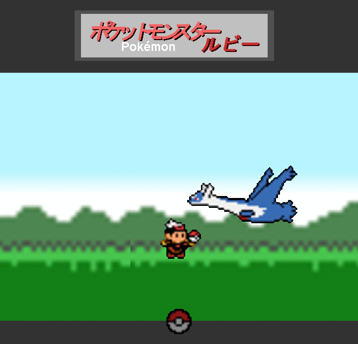
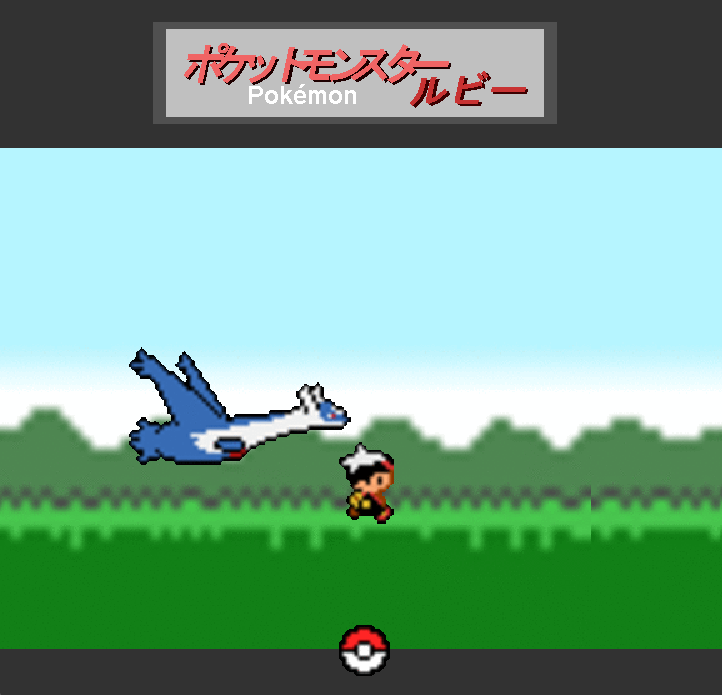

# pixel-interactive-animation

Java (AWT / `javax.sound.sampled`) で作った、ドット絵キャラクターが動くインタラクティブアニメーションです。
勝敗やスコアのある「ゲーム」ではなく、マウス操作に反応してキャラクターが動くだけのシンプルなトイです。

見た目はポケモン（ラティオス等）をモチーフにしています。素材の著作権については
[NOTICE.md](./NOTICE.md) を参照してください。

## できること

- **マウスを動かす** … 操作キャラの向きが左右に切り替わる
- **ドラッグする** … 操作キャラが走るモーションになる
- **モンスターボールをクリック** … ポケモン（ラティオス）を召喚・回収する
- **タイトルロゴをクリック** … 効果音がランダムに再生される

## 動作環境

- JDK 8 以上（Java の AWT / `javax.sound.sampled` のみを使用しており、追加ライブラリは不要です）

## ビルドと実行

```bash
# コンパイル
javac -d build src/*.java

# 実行（必ずプロジェクトのルートディレクトリで実行してください）
java -cp build InteractiveAnimation
```

> 画像・音声を `src/images/...` `src/sounds/...` という相対パスで読み込んでいるため、
> `build` ディレクトリではなく **プロジェクトルートで** `java` コマンドを実行する必要があります。

## スクリーンショット

| 呼び出し前 | 呼び出し中 |
| --- | --- |
|  |  |

## ディレクトリ構成

```
.
├── src/
│   ├── InteractiveAnimation.java   # メインクラス（ウィンドウ・描画・入力処理）
│   ├── ClipProB.java         # 効果音再生用ユーティリティ
│   ├── images/                # スプライト・背景画像
│   └── sounds/                # 効果音
├── docs/
│   └── screenshots/            # README用スクリーンショット
├── NOTICE.md                  # 同梱素材の著作権に関する注意（必読）
├── LICENSE
└── README.md
```

## 素材の著作権について

画像・効果音の一部はポケモンシリーズのキャラクター・音声を元にしています。
公開・再配布の前に **[NOTICE.md](./NOTICE.md) を必ずお読みください。**

## ライセンス

ソースコード（`*.java`）は [MIT License](./LICENSE) の下で公開しています。
画像・音声素材はこのライセンスの対象外です。詳細は [NOTICE.md](./NOTICE.md) を参照してください。
